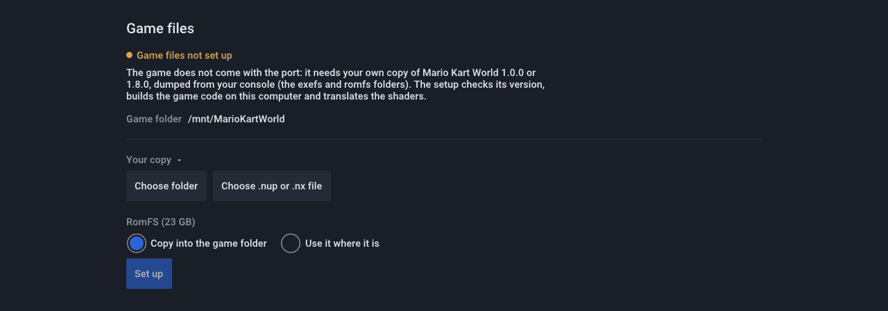

<p align="center"></p>

# Mario Kart World: Pit Stop

<!-- i18n-bar:start -->
<p align="center">
  <b>English</b> ·
  <a href="docs/i18n/README.zh-CN.md">简体中文</a> ·
  <a href="docs/i18n/README.es.md">Español</a> ·
  <a href="docs/i18n/README.ar.md">العربية</a> ·
  <a href="docs/i18n/README.hi.md">हिन्दी</a> ·
  <a href="docs/i18n/README.pt-BR.md">Português (Brasil)</a> ·
  <a href="docs/i18n/README.pt-PT.md">Português (Portugal)</a> ·
  <a href="docs/i18n/README.de.md">Deutsch</a>
</p>
<!-- i18n-bar:end -->

A native PlayStation 5 homebrew port (`PPSA99193`) of [**mkw-recomp**](https://github.com/adriadam10/mkw-recomp),
Adrià's static recompilation of *Mario Kart World* (Nintendo Switch 2, versions 1.8.0 and 1.0.0). It needs your own copy of the
game, dumped from your own Switch 2 console: nothing of the game is in this repository or in its releases.

**It is a static recompilation, not an emulator.** The game's AArch64 code is translated to C ahead of time and
compiled for the PS5's x86-64 Zen 2 CPU (`ps5-high144` guest address layout); there is no CPU interpreter or JIT. The
GPU is not emulated either: NVN2, the Switch 2 graphics API, is reimplemented on top of Vulkan at the API level using
Mesa's RADV driver for the PS5, and the game's SM86 shaders are translated to SPIR-V ahead of time on your PC. Nintendo
SDK functions (`nn::*`) are replaced by name with our own code.

> **Upstream PC project:** Looking for the Linux or Windows version? See [**adriadam10/mkw-recomp**](https://github.com/adriadam10/mkw-recomp) ([PC instructions below](#playing-on-pc-linux-and-windows)).

## Status (PS5)

Early, and moving fast. On 18/11/2026 on a base PS5:

- **Boot, movies, menus and races work**, with direct Vulkan display over RADV, stereo sound through `sceAudioOut`, and
  up to four signed-in DualSense controllers with rumble and PlayStation button prompts.
- **Races run at 60 fps by default, without frame generation**: about 57-59 fps on average in a Grand Prix benchmark,
  with the occasional slower frame keeping the race at 0.95-0.98x real time (see [Performance](#performance)). The
  game's 30 fps mode (full speed) and frame generation are options in **Pit Stop > Display**.
- **Multiplayer:** the game's split screen (one DualSense per signed-in player) and its local wireless mode over the
  LAN, between PS5s or with the PC build of the same version ([docs/ps5/multiplayer.md](docs/ps5/multiplayer.md)). There is no
  Nintendo online play.
- **Pit Stop in-game overlay.** Press **Options + touchpad click** at any time to open **Pit Stop**, a controller-first
  settings menu with quick rows (**Master volume**, **Vibration strength**, **Performance HUD**), every settings
  category and live DualSense button remapping, saved to `/app0/mkw.ini`.
- **Known issues ([docs/project/roadmap.md](docs/project/roadmap.md)):**
  - *Long sessions:* free memory falls race after race as the game keeps earlier courses' data; when it runs low,
    textures can come out corrupted or missing. Restart the title after a few races if that happens.
  - *Sparse tiles:* from boot a few sparse texture tiles stay unloaded: minor texture corruption near the start line
    and a black-and-white race intro.
  - *Multiplayer:* the first race on a course can drop a player whose shaders are still compiling; later races work.
    Split screen at the 60 fps default: 2 players average ~46 fps (the race in slow motion, 0.77x), 3 or 4 players
    ~24 fps (0.40x); see [Performance](#performance).
  - *Menus:* mode, character and vehicle select screens still differ slightly from the console.

## What you need ("You bring")

1. **Your own *Mario Kart World* dump** from your own Nintendo Switch 2: version **1.8.0** (`exefs/main` build ID
   `d00e4f399e411d06`) or 1.0.0 (`9e244438c3d8ef1c`), as decrypted `exefs/` and `romfs/` folders or a `.nup` file. A
   console dump that holds the 1.8.0 update in `updates/` is used as it is, and 1.8.0 is built when both are there.
2. **A jailbroken PS5** running a homebrew payload loader (`etaHEN` or `elfldr`), `kstuff`, and **ShadowMountPlus 1.7
   Beta 5** or newer (which mounts and registers `/data/homebrew/PPSA99193` on the home screen). Firmware support
   follows your jailbreak, `kstuff`, and RADV homebrew environment (see [docs/ps5/ps5.md](docs/ps5/ps5.md)).
3. **A PC with about 30 GB free** on the same network as the PS5, to build the title from your dump:
   - **Windows 10 or 11 (64-bit):** nothing else to install, no WSL. The Windows builder carries its own Python, zig
     and glslc ([Windows steps](#installing-on-windows-no-wsl)).
   - **Linux x86-64 or WSL2:** `clang`, `lld` and Python 3 ([Linux steps](#installing-and-updating-on-ps5-linux-or-wsl2)).

## Installing on Windows (no WSL)

1. **Put the placeholder title on the PS5.** Unzip `mkw-pit-stop-<version>-ps5-placeholder-PPSA99193.zip` from
   [**Releases**](https://github.com/exploitizm/mkw-pit-stop/releases) and upload its `PPSA99193` folder to `/data/homebrew/` with an FTP client (FileZilla, WinSCP), so that
   `/data/homebrew/PPSA99193/eboot.bin` exists. Once ShadowMountPlus registers it, launch **Mario Kart World: Pit
   Stop**: it shows **Game files missing** and `Console IP: <address> (port 19913)`. Leave that screen open; the PS5
   receives files only while it is shown.
   <p align="center"></p>
2. **Unpack the builder on the PC.** Download `mkw-pit-stop-<version>-ps5-builder-windows-x86_64.zip`, right-click it,
   **Properties**, tick **Unblock**, then extract it to a short folder on a drive with 30 GB free, such as
   `C:\PitStop` (not `Program Files` or OneDrive).
3. **Build and send.** Run `mkw.exe` from that folder. On **Game files**, choose your dump with **Choose folder** (or
   **Choose .nup or .nx file**); under **Build for PS5**, type the address from the PS5 screen into **PS5 IP** and
   press **Build for PS5**. The desktop **Set up** button is not needed for the PS5. Or, from a Command Prompt in that
   folder:
   ```bat
   prepare_ps5.bat --source "D:\Dumps\MKW" --send 192.168.1.50
   ```
   <p align="center"></p>
4. **Start the game.** While the PC builds, the PS5 screen shows its step and progress; it shows **Transfer
   complete!** when every file has arrived and been checked: press
   **Cross**, then launch **Mario Kart World: Pit Stop** again.

**Your copy already on the PS5?** Tick **My game files are already on the PS5** and type its folder there (for
example `/data/mkw`, with `exefs` and `romfs` in it or in its `updates\<version>`): only the game code and
shaders are sent, and the title finds the game in that folder. The PC still needs your dump to build.

**No network? Use a USB drive.** In step 3, pick **To a USB drive** and **Choose drive** instead of typing the PS5's
address: the title is written to `homebrew\PPSA99193` on the drive (**exFAT**, about 25 GB free), and
ShadowMountPlus finds it there once the drive is plugged into the PS5 (it scans `/mnt/usb0`-`usb7/homebrew/`).
The placeholder of step 1 is not needed for this; if it is installed, remove `/data/homebrew/PPSA99193` first so
only one copy of the title is registered. Building again updates only what changed on the drive.

If the PS5 stays on **Waiting for connection**, check the address and that both are on the same network; a failed
build is explained in `logs/setup.log` beside `mkw.exe`. To update, unpack the new builder and build again.

## Installing and updating on PS5 (Linux or WSL2)

Because `eboot.bin` links the recompiled game code and `spirv/` holds the game's translated shaders, **no ready-to-run
`eboot.bin` or `spirv/` is distributed**. You build the `PPSA99193` title folder on your PC from the game-free release
builder and your own dump:

1. Download `mkw-pit-stop-<version>-ps5-builder-linux-x86_64.tar.zst` from [**Releases**](https://github.com/exploitizm/mkw-pit-stop/releases), check its digest against
   `SHA256SUMS`, and unpack it on Linux or WSL2:
   ```sh
   tar --zstd -xf mkw-pit-stop-*-ps5-builder-linux-x86_64.tar.zst
   cd mkw-pit-stop-*
   ```
2. Run `prepare_ps5.py` pointing at your *Mario Kart World* dump (a folder or a `.nup` file):
   ```sh
   python3 prepare_ps5.py --source /path/to/your/mkw-dump --out ./PPSA99193
   ```
   The script finds your dump's version (1.8.0 or 1.0.0), translates the AArch64 ExeFS to C (`ps5-high144`), compiles and links
   `eboot.bin` against the prebuilt runtime and PS5 RADV archive, downloads NVIDIA's `nvdisasm` and `ptxas` (pinned by
   SHA-256) to generate the SM86 instruction spec locally, translates all 11,561 shaders into `PPSA99193/spirv/`, and
   stages `exefs/` and `romfs/` into `PPSA99193/`.
3. Transfer `PPSA99193` to `/data/homebrew/PPSA99193` on your PS5 via FTP or USB — or pass `--deploy <PS5_IP>` to
   upload, verify every file by SHA-256, and refresh ShadowMountPlus's registered `param.json` and `icon0.png` in
   `/user/app/PPSA99193/sce_sys`.
4. Launch **Mario Kart World: Pit Stop** from the PS5 home screen.

**Updating:** unpack the newer builder and run `prepare_ps5.py` with the same `--work` and `--out` directories. Steps
whose inputs did not change (such as `romfs/` and unchanged shaders) are skipped, and your saves (`profile/`) and
settings (`mkw.ini`) on the console are kept.

## Pit Stop settings overlay

Press **Options + touchpad click** on the DualSense (or **F1** on desktop) from any screen to open **Pit Stop**
([docs/ps5/pit-stop.md](docs/ps5/pit-stop.md)):

| Control | Action |
|---|---|
| **Options + touchpad click** | Open or close Pit Stop from any screen |
| **D-pad / Left stick Up & Down** | Move one row |
| **D-pad / Left stick Left & Right** | Adjust the focused setting (Off/On or step value) |
| **Circle / Cross** | Confirm / Back (follows your Nintendo or Xbox button layout) |
| **L1 / R1** | Previous / Next category inside **All settings** |

- **Quick rows** on the first screen adjust **Master volume** (0–100%), **Vibration strength** (0–300%), and
  **Performance HUD** (Off, FPS, Full) live.
- **All settings** opens **Display**, **Graphics**, **Controls** (with live per-action button capture), **Audio**,
  **General**, **Advanced**, **Hacks** (unlock all drivers, vehicles, stickers and Special Cup) and **Multiplayer**.
  Changes save automatically to `/app0/mkw.ini`.

## Playing on PC (Linux and Windows)

From upstream [mkw-recomp](https://github.com/adriadam10/mkw-recomp):

<p align="center">
  
  
</p>

1. Dump Mario Kart World 1.0.0 or 1.8.0 from your Switch 2 (`exefs/` and `romfs/`, decrypted).
2. Download the PC launcher from [mkw-recomp Releases](https://github.com/adriadam10/mkw-recomp/releases): on Linux the
   `.AppImage` (keeps the game it builds in `~/.local/share/mkw-recomp`; glibc 2.31 or newer), on Windows the `.zip`.
   Either needs about 30 GB free.
3. Run the AppImage or `mkw.exe`, open **Game files**, point it at your dump and press **Prepare**, then **Play**.

## Building from source

### PS5 native target (`PPSA99193`)

See [docs/ps5/ps5.md](docs/ps5/ps5.md) and [tools/ps5/README.md](tools/ps5/README.md) for the pinned `PS5_VulkanTemplate`,
`PS5_Vulkan`, `PS5_Mesa` and `PS5_PayloadSDK` checkouts:

```sh
python3 recomp/gen.py --exefs "$MKW_GAME/exefs" --guest-layout ps5-high144 \
    --out build/ps5-game/generated --patches recomp/patches-mkw.txt
python3 tools/shaders/extract.py && python3 tools/shaders/translate.py
python3 tools/ps5/build_game.py --stack "$stack" --include "$headers" \
    --generated build/ps5-game/generated --exefs "$MKW_GAME/exefs"
python3 tools/ps5/deploy.py <PS5_IP> --game
```

To pack a game-free PS5 builder release from the runtime inventory (`--inventory`):

```sh
python3 tools/ps5/build_game.py --stack "$stack" --include "$headers" --inventory
python3 tools/ps5/release_ps5.py --stack "$stack" --version 0.1.0
```

### Linux and Windows host builds

Details in [tools/build/README.md](tools/build/README.md):

```sh
python3 recomp/gen.py --exefs game/exefs --out build/generated --jobs 8 --patches recomp/patches-mkw.txt
python3 tools/shaders/extract.py && python3 tools/shaders/translate.py
python3 tools/build/build.py              # build/mkw; --target windows builds mkw.exe with llvm-mingw
build/mkw
```

| Folder | Contents |
|---|---|
| [recomp/](recomp/README.md) | The generator: AArch64 → C |
| [runtime/](runtime/README.md) | What plays the console: kernel, memory, SDK replacements, NVN2 over Vulkan, audio, input, Pit Stop and launcher |
| [sm86/](sm86/README.md) | The shader translator: SM86 SASS → GLSL → SPIR-V |
| [tools/](tools/README.md) | Analysis, setup, build, PS5 packaging, game runs and diagnostics |
| [tests/](tests/README.md) | Tests without the game or a GPU, in the CI on Linux and Windows |
| [docs/](docs/README.md) | PS5 architecture, Pit Stop, research, sources, roadmap and performance |
| [i18n/](i18n/README.md) | The menu's texts as gettext files (`mkw.pot`, one `.po` per language) |
| [server/](server/README.md) | The lobby server for online local-wireless play (`server/lobby`) |
| `.github/` | CI, issue and pull request templates |

At the root: `pyproject.toml` and `uv.lock` (the Python environment of the tools), `Makefile` (shortcuts for the
release and CI flows), `.gitignore`, `LICENSE`,
`CONTRIBUTING.md`, `CHANGELOG.md` (each release's changes, its notes), `AGENTS.md` (a guide for coding agents).

## Performance

On a base PS5, Mario Kart World 1.8.0, a Grand Prix race benchmark (`tools/ps5/bench.py`, 210 s of racing, 1080p,
frame generation off):

| Date | Frame rate setting | Average frame time | Typical frame | 1% low | Race speed |
|---|---|---|---|---|---|
| 20/11/2026 | 60 fps (the new default) | 17.0–17.4 ms (57–59 fps) | 16.7 ms (at the cap) | 35–41 fps | 0.95–0.98x |
| 16/11/2026 | 30 fps (the previous default) | 33.3 ms | 33.3 ms | | 1.00x |

The new default is untested on the console as it ships: these numbers come from benchmark races with the runtime's
performance logging on (`MKW_TRACE=perf`, which costs a little), set to 60 fps by hand. Menus, time trials, long
sessions and other courses have not been played at the new default yet.

**Split screen** (22/11/2026, the same benchmark at 60 fps, one build for all four runs, `ps5-0.1.0-12-g77aae4a`; every
player is driven by the script):

| Players | Average frame time | Typical frame | 1% low | 0.1% low | Worst frame | Race speed |
|---|---|---|---|---|---|---|
| 1 | 17.1 ms (58.6 fps) | 16.7 ms | 39.8 fps | 20.5 fps | 74 ms | 0.98x |
| 2 | 21.7 ms (46.2 fps) | 21.3 ms | 32.2 fps | 18.6 fps | 70 ms | 0.77x |
| 3 | 41.9 ms (23.9 fps) | 42.2 ms | 19.5 fps | 14.3 fps | 99 ms | 0.40x |
| 4 | 41.9 ms (23.9 fps) | 42.7 ms | 19.2 fps | 14.2 fps | 99 ms | 0.40x |

At the 60 fps setting the game counts every frame as 1/60 s, so frames slower than that make the race slow motion:
2 players run at about three quarters of real time, 3 and 4 at under half. Three players cost the same as four. At
the 30 fps setting a frame may take 33.3 ms at full speed: by these frame times (not measured at 30 yet), 2 players
would hold 30 fps and 3 or 4 would still run at about 0.8x.

About 2% of race frames take over 20 ms: they are where a course streams in new textures, and they set the 1% lows
and the slight slow motion. What was measured and what is left is in
[docs/project/roadmap.md](docs/project/roadmap.md) and [docs/ps5/ps5.md](docs/ps5/ps5.md#frame-rate); PC numbers are in
[docs/project/performance.md](docs/project/performance.md).

## Reporting bugs

See [CONTRIBUTING.md](CONTRIBUTING.md). Report PS5 issues on [this fork's issues](https://github.com/exploitizm/mkw-pit-stop/issues) and attach the console kernel log (`klog`, prefixed with
`[Mario Kart World: Pit Stop]`) and `logs/setup.log` from the PC builder. For desktop issues, attach `logs/mkw.log` and
`logs/setup.log`. Never attach game files, dumps, or `eboot.bin` binaries built from your dump.

## Licenses, credits and disclaimer

This repository's source code is under the [MIT License](LICENSE) (`Copyright (c) 2026 Adrià`).

**The PS5 release files are GPL-3.0-or-later.** Every PS5 title links the payload SDK fork's platform layer and
`PS5_Vulkan`'s start-up code (GPL-3.0-or-later), so the placeholder title, the builder's `ps5-bundle/` and every title
you build with them are under GPL-3.0-or-later as a whole; mkw-recomp's own code stays MIT. Each release carries
`LEGAL.txt` and `licenses/` (every part with its licence, copyright and source revision) and attaches the complete
source of every part as `source/*.tar.gz` (`source/SOURCES.txt`), made by
[tools/ps5/release_notices.py](tools/ps5/release_notices.py).

- **Upstream project:** [**mkw-recomp**](https://github.com/adriadam10/mkw-recomp) by Adrià — the AArch64→C lifter,
  Switch 2 kernel and `nn::*` SDK replacements, NVN2-over-Vulkan renderer, and offline SM86→SPIR-V shader translator.
- **MIT and permissive projects** (`LICENSE.*` files in [recomp/](recomp/), [runtime/](runtime/),
  [sm86/decode/](sm86/decode/) and [runtime/third_party/](runtime/third_party/README.md)):
  [totk-pc-recomp](https://github.com/valentderah/totk-pc-recomp) and its Linux port,
  [SavageWindRecomp](https://github.com/Revivedx/SavageWindRecomp),
  [DocumentSASS](https://github.com/0xD0GF00D/DocumentSASS) and
  [nvsass-disassembler](https://github.com/reoLantern/nvsass-disassembler),
  [Ryujinx](https://git.ryujinx.app/ryubing/ryujinx), [Mesa NAK](https://gitlab.freedesktop.org/mesa/mesa/-/tree/main/src/nouveau/compiler),
  [mario-kart-world-save-editor](https://github.com/Ca1nM/mario-kart-world-save-editor), Dear ImGui,
  [bc7enc_rdo](https://github.com/richgel999/bc7enc_rdo), AMD FidelityFX FSR 1, Vulkan Memory Allocator, Roboto and
  Lato.
- **PS5 toolchain and runtime:** [PS5_VulkanTemplate](https://github.com/mihawk-99/PS5_VulkanTemplate) (MIT, Sascha
  Willems and Mihawk), [PS5_Mesa](https://github.com/mihawk-99/PS5_Mesa) (MIT, RADV for PS5),
  [PS5_Vulkan](https://github.com/mihawk-99/PS5_Vulkan) and [PS5_PayloadSDK](https://github.com/mihawk-99/PS5_PayloadSDK)
  (GPL-3.0-or-later, Mihawk and [John Törnblom / ps5-payload-dev](https://github.com/ps5-payload-dev/sdk)), and
  [ShadowMountPlus](https://github.com/drakmor/shadowMountPlus). When linked into a PS5 title with the payload SDK
  platform layer and `PS5_Vulkan` CRT/stubs, the combined PS5 title binary is covered by GPL-3.0-or-later
  (`LEGAL.txt` and `licenses/` inside the built title).
- **Research and design ideas only** (no code copied from GPL or unlicensed projects): eden-nx2, Hookshot,
  PS5_Hookshot, EglantinePS5, AnyPS5, prosper, and shadPS4. Every source is documented in
  [docs/project/research.md](docs/project/research.md#sources).

**Disclaimer:** *Mario Kart World* and *Mario* are trademarks of Nintendo. "PlayStation" and "PS5" are trademarks of
Sony Interactive Entertainment Inc. This project is not affiliated with or endorsed by Nintendo, Sony Interactive
Entertainment, or any game publisher, contains no game code, shaders or assets, and does not help to obtain them.
