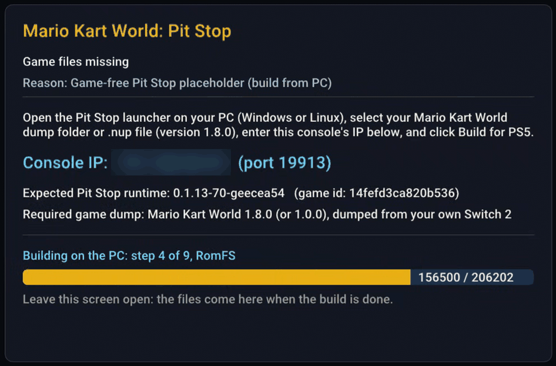
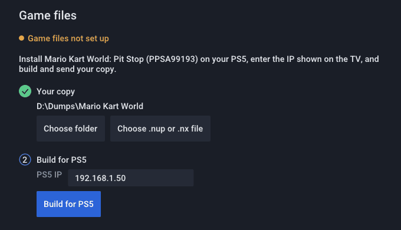

<!-- translated from README.md 84c6832c04b6 body 0de50b629bcb -->

<p align="center"></p>

<h1 align="center">Mario Kart World: Pit Stop</h1>

<p align="center">
  <b>Ein nativer PlayStation-5-Homebrew-Port von Mario Kart World (Nintendo Switch 2), per statischer Rekompilierung.</b>
</p>

<p align="center">
  <a href="https://github.com/exploitizm/mkw-pit-stop/releases/latest"></a>
</p>

<p align="center">
  <b><a href="https://github.com/exploitizm/mkw-pit-stop/releases">Releases</a></b> ·
  <a href="../../CHANGELOG.md">Änderungen</a> ·
  <a href="../../CONTRIBUTING.md">Mitwirken</a> ·
  <a href="../../docs/project/roadmap.md">Roadmap</a> ·
  <a href="../../docs/ps5/ps5.md">PS5-Hinweise</a> ·
  <a href="https://github.com/exploitizm/mkw-pit-stop/issues">Issues</a>
</p>

<!-- i18n-bar:start -->
<p align="center">
  <a href="../../README.md">English</a> ·
  <a href="README.zh-CN.md">简体中文</a> ·
  <a href="README.es.md">Español</a> ·
  <a href="README.ar.md">العربية</a> ·
  <a href="README.hi.md">हिन्दी</a> ·
  <a href="README.pt-BR.md">Português (Brasil)</a> ·
  <a href="README.pt-PT.md">Português (Portugal)</a> ·
  <b>Deutsch</b>
</p>
<!-- i18n-bar:end -->

Ein nativer PlayStation-5-Homebrew-Port (`PPSA99193`) von [**mkw-recomp**](https://github.com/adriadam10/mkw-recomp),
Adriàs statischer Rekompilierung von *Mario Kart World* (Nintendo Switch 2, Versionen 1.8.0 und 1.0.0). Du brauchst
deine eigene Kopie des Spiels, von deiner eigenen Switch-2-Konsole gedumpt: nichts vom Spiel steckt in diesem Repository
oder in seinen Releases.

**Es ist eine statische Rekompilierung, kein Emulator.** Der AArch64-Code des Spiels wird vorab nach C übersetzt und
für die x86-64-Zen-2-CPU der PS5 kompiliert (Gast-Adresslayout `ps5-high144`); es gibt keinen CPU-Interpreter und kein
JIT. Auch die GPU wird nicht emuliert: NVN2, die Grafik-API der Switch 2, ist auf API-Ebene über Vulkan mit Mesas
RADV-Treiber für die PS5 neu umgesetzt, und die SM86-Shader des Spiels werden vorab auf deinem PC nach SPIR-V
übersetzt. Funktionen des Nintendo-SDK (`nn::*`) werden über ihren Namen durch eigenen Code ersetzt.

> **PC-Projekt (Upstream):** Suchst du die Linux- oder Windows-Version? Siehe
> [**adriadam10/mkw-recomp**](https://github.com/adriadam10/mkw-recomp) ([PC-Anleitung unten](#spielen-am-pc-linux-und-windows)).

## Stand (PS5)

Früh, und es geht schnell voran. Stand 18.11.2026 auf einer Standard-PS5:

- **Start, Videos, Menüs und Rennen funktionieren**, mit direkter Vulkan-Ausgabe über RADV, Stereoton über
  `sceAudioOut` und bis zu vier angemeldeten DualSense-Controllern mit Vibration und PlayStation-Tastensymbolen.
- **Rennen laufen standardmäßig mit 60 fps, ohne Frame-Generierung**: im Schnitt etwa 57-59 fps in einem
  Grand-Prix-Benchmark; einzelne langsamere Frames halten das Rennen bei 0,95-0,98x Echtzeit (siehe
  [Leistung](#leistung)). Der 30-fps-Modus des Spiels (volle Geschwindigkeit) und die Frame-Generierung sind
  Optionen unter **Pit Stop > Display**.
- **Mehrspieler:** der geteilte Bildschirm des Spiels (ein DualSense pro angemeldetem Spieler) und sein lokaler
  Drahtlosmodus über das LAN, zwischen PS5-Konsolen oder mit der PC-Version derselben Version
  ([docs/ps5/multiplayer.md](../../docs/ps5/multiplayer.md)). Es gibt kein Online-Spiel über Nintendo.
- **Pit-Stop-Overlay im Spiel.** Drücke jederzeit **Options + Touchpad-Klick**, um **Pit Stop** zu öffnen, ein
  Einstellungsmenü für den Controller mit Schnellzeilen (**Master volume**, **Vibration strength**, **Performance HUD**),
  allen Einstellungskategorien und live umbelegbaren DualSense-Tasten, gespeichert in `/app0/mkw.ini`.
- **Bekannte Probleme ([docs/ps5/roadmap.md](../../docs/ps5/roadmap.md)):**
  - *Lange Sitzungen:* der freie Speicher sinkt von Rennen zu Rennen, weil das Spiel Daten früherer Strecken behält;
    wird er knapp, können Texturen fehlerhaft sein oder fehlen. Starte den Titel nach einigen Rennen neu, falls das
    passiert.
  - *Sparse-Kacheln:* ab dem Start bleiben einige Sparse-Texturkacheln ungeladen: leichte Texturfehler nahe der
    Startlinie und ein schwarz-weißes Renn-Intro.
  - *Mehrspieler:* das erste Rennen auf einer Strecke kann einen Spieler verlieren, dessen Shader noch kompilieren;
    spätere Rennen funktionieren. Der geteilte Bildschirm läuft in vollen Szenen unter 30 fps.
  - *Menüs:* Modus-, Charakter- und Fahrzeugauswahl weichen noch leicht von der Konsole ab.

## Was du brauchst

1. **Deinen eigenen Dump von *Mario Kart World*** von deiner eigenen Nintendo Switch 2: Version **1.8.0**
   (`exefs/main`, Build-ID `d00e4f399e411d06`) oder 1.0.0 (`9e244438c3d8ef1c`), als entschlüsselte Ordner `exefs/` und
   `romfs/` oder als `.nup`-Datei. Ein Konsolen-Dump mit dem Update 1.8.0 in `updates/` wird so verwendet, wie er ist,
   und wenn beide vorhanden sind, wird 1.8.0 gebaut.
2. **Eine gejailbreakte PS5** mit einem Homebrew-Payload-Loader (`etaHEN` oder `elfldr`), `kstuff` und
   **ShadowMountPlus 1.7 Beta 5** oder neuer (bindet `/data/homebrew/PPSA99193` ein und registriert es auf dem
   Startbildschirm). Welche Firmware unterstützt wird, hängt von deinem Jailbreak, `kstuff` und der RADV-Homebrew-Umgebung
   ab (siehe [docs/ps5/ps5.md](../../docs/ps5/ps5.md)).
3. **Einen PC mit etwa 30 GB freiem Platz** im selben Netzwerk wie die PS5, um den Titel aus deinem Dump zu bauen:
   - **Windows 10 oder 11 (64 Bit):** nichts weiter zu installieren, kein WSL. Der Windows-Builder bringt sein eigenes
     Python, zig und glslc mit ([Schritte für Windows](#installation-unter-windows-ohne-wsl)).
   - **Linux x86-64 oder WSL2:** `clang`, `lld` und Python 3 ([Schritte für Linux](#installation-und-aktualisierung-auf-der-ps5-linux-oder-wsl2)).

## Installation unter Windows (ohne WSL)

1. **Lege den Platzhalter-Titel auf die PS5.** Entpacke `mkw-pit-stop-<version>-ps5-placeholder-PPSA99193.zip` aus den
   [**Releases**](https://github.com/exploitizm/mkw-pit-stop/releases) und lade seinen Ordner `PPSA99193` mit einem
   FTP-Programm (FileZilla, WinSCP) nach `/data/homebrew/` hoch, sodass `/data/homebrew/PPSA99193/eboot.bin` existiert.
   Sobald ShadowMountPlus ihn registriert, starte **Mario Kart World: Pit Stop**: er zeigt **Game files missing** und
   `Console IP: <Adresse> (port 19913)`. Lass diesen Bildschirm offen; die PS5 empfängt Dateien nur, solange er
   angezeigt wird.
   <p align="center"></p>
2. **Entpacke den Builder auf dem PC.** Lade `mkw-pit-stop-<version>-ps5-builder-windows-x86_64.zip` herunter, klicke
   mit der rechten Maustaste darauf, **Eigenschaften**, setze den Haken bei **Zulassen** und entpacke es in einen kurzen
   Ordner auf einem Laufwerk mit 30 GB freiem Platz, etwa `C:\PitStop` (nicht `Program Files` oder OneDrive).
3. **Bauen und senden.** Starte `mkw.exe` aus diesem Ordner. Wähle unter **Game files** deinen Dump mit
   **Choose folder** (oder **Choose .nup or .nx file**); tippe unter **Build for PS5** die Adresse vom PS5-Bildschirm in
   **PS5 IP** ein und drücke **Build for PS5**. Die Desktop-Schaltfläche **Set up** wird für die PS5 nicht gebraucht.
   Oder aus einer Eingabeaufforderung in diesem Ordner:
   ```bat
   prepare_ps5.bat --source "D:\Dumps\MKW" --send 192.168.1.50
   ```
   <p align="center"></p>
4. **Starte das Spiel.** Während der PC baut, zeigt der PS5-Bildschirm Schritt und Fortschritt; er zeigt
   **Transfer complete!**, wenn alle Dateien angekommen und geprüft sind: drücke **Kreuz** und starte dann
   **Mario Kart World: Pit Stop** erneut.

**Deine Kopie liegt schon auf der PS5?** Setze den Haken bei **My game files are already on the PS5** und tippe dort
ihren Ordner ein (zum Beispiel `/data/mkw`, mit `exefs` und `romfs` darin oder in seinem `updates\<version>`): nur der
Spielcode und die Shader werden gesendet, und der Titel findet das Spiel in diesem Ordner. Der PC braucht deinen Dump
trotzdem zum Bauen.

**Kein Netzwerk? Nimm einen USB-Stick.** Wähle in Schritt 3 **To a USB drive** und **Choose drive**, statt die Adresse
der PS5 einzutippen: der Titel wird nach `homebrew\PPSA99193` auf dem Laufwerk geschrieben (**exFAT**, etwa 25 GB frei),
und ShadowMountPlus findet ihn dort, sobald das Laufwerk an der PS5 steckt (es durchsucht `/mnt/usb0`-`usb7/homebrew/`).
Der Platzhalter aus Schritt 1 ist dafür nicht nötig; ist er installiert, entferne zuerst `/data/homebrew/PPSA99193`,
damit nur eine Kopie des Titels registriert ist. Ein erneuter Build aktualisiert nur, was sich auf dem Laufwerk
geändert hat.

Bleibt die PS5 bei **Waiting for connection**, prüfe die Adresse und ob beide im selben Netzwerk sind; ein
fehlgeschlagener Build wird in `logs/setup.log` neben `mkw.exe` erklärt. Zum Aktualisieren entpackst du den neuen
Builder und baust erneut.

## Installation und Aktualisierung auf der PS5 (Linux oder WSL2)

Weil `eboot.bin` den rekompilierten Spielcode einbindet und `spirv/` die übersetzten Shader des Spiels enthält, **wird
weder ein startfertiges `eboot.bin` noch `spirv/` verteilt**. Du baust den Titelordner `PPSA99193` auf deinem PC aus dem
spielfreien Release-Builder und deinem eigenen Dump:

1. Lade `mkw-pit-stop-<version>-ps5-builder-linux-x86_64.tar.zst` aus den
   [**Releases**](https://github.com/exploitizm/mkw-pit-stop/releases) herunter, prüfe seine Prüfsumme gegen
   `SHA256SUMS` und entpacke es unter Linux oder WSL2:
   ```sh
   tar --zstd -xf mkw-pit-stop-*-ps5-builder-linux-x86_64.tar.zst
   cd mkw-pit-stop-*
   ```
2. Starte `prepare_ps5.py` mit deinem *Mario-Kart-World*-Dump (ein Ordner oder eine `.nup`-Datei):
   ```sh
   python3 prepare_ps5.py --source /path/to/your/mkw-dump --out ./PPSA99193
   ```
   Das Skript erkennt die Version deines Dumps (1.8.0 oder 1.0.0), übersetzt das AArch64-ExeFS nach C (`ps5-high144`),
   kompiliert und linkt `eboot.bin` gegen die vorgebaute Laufzeit und das PS5-RADV-Archiv, lädt NVIDIAs `nvdisasm` und
   `ptxas` herunter (per SHA-256 festgelegt), um die SM86-Befehlsspezifikation lokal zu erzeugen, übersetzt alle 11.561
   Shader nach `PPSA99193/spirv/` und legt `exefs/` und `romfs/` in `PPSA99193/` ab.
3. Übertrage `PPSA99193` per FTP oder USB nach `/data/homebrew/PPSA99193` auf deiner PS5 — oder gib `--deploy <PS5_IP>`
   an, um hochzuladen, jede Datei per SHA-256 zu prüfen und das von ShadowMountPlus registrierte `param.json` und
   `icon0.png` in `/user/app/PPSA99193/sce_sys` zu erneuern.
4. Starte **Mario Kart World: Pit Stop** vom Startbildschirm der PS5.

**Aktualisieren:** entpacke den neueren Builder und starte `prepare_ps5.py` mit denselben Ordnern für `--work` und
`--out`. Schritte, deren Eingaben sich nicht geändert haben (etwa `romfs/` und unveränderte Shader), werden übersprungen,
und deine Spielstände (`profile/`) und Einstellungen (`mkw.ini`) auf der Konsole bleiben erhalten.

## Pit-Stop-Einstellungs-Overlay

Drücke auf dem DualSense **Options + Touchpad-Klick** (oder **F1** am Desktop) in jedem Bildschirm, um **Pit Stop**
zu öffnen ([docs/ps5/pit-stop.md](../../docs/ps5/pit-stop.md)):

| Steuerung | Aktion |
|---|---|
| **Options + Touchpad-Klick** | Pit Stop in jedem Bildschirm öffnen oder schließen |
| **Steuerkreuz / linker Stick hoch und runter** | Eine Zeile weiter |
| **Steuerkreuz / linker Stick links und rechts** | Die gewählte Einstellung ändern (Aus/An oder Schrittwert) |
| **Kreis / Kreuz** | Bestätigen / Zurück (folgt deiner Nintendo- oder Xbox-Tastenbelegung) |
| **L1 / R1** | Vorherige / nächste Kategorie in **All settings** |

- **Schnellzeilen** auf dem ersten Bildschirm ändern live **Master volume** (0–100 %), **Vibration strength** (0–300 %)
  und **Performance HUD** (Off, FPS, Full).
- **All settings** öffnet **Display**, **Graphics**, **Controls** (mit live Tastenbelegung pro Aktion), **Audio**,
  **General**, **Advanced**, **Hacks** (alle Fahrer, Fahrzeuge, Sticker und den Spezial-Cup freischalten) und
  **Multiplayer**. Änderungen werden automatisch in `/app0/mkw.ini` gespeichert.

## Spielen am PC (Linux und Windows)

Aus dem Upstream-Projekt [mkw-recomp](https://github.com/adriadam10/mkw-recomp):

<p align="center">
  
  
</p>

1. Dumpe Mario Kart World 1.0.0 oder 1.8.0 von deiner Switch 2 (`exefs/` und `romfs/`, entschlüsselt).
2. Lade den PC-Launcher aus den [Releases von mkw-recomp](https://github.com/adriadam10/mkw-recomp/releases) herunter:
   unter Linux das `.AppImage` (das gebaute Spiel liegt in `~/.local/share/mkw-recomp`; glibc 2.31 oder neuer), unter
   Windows das `.zip`. Beide brauchen etwa 30 GB freien Platz.
3. Starte das AppImage oder `mkw.exe`, öffne **Game files**, wähle deinen Dump und drücke **Prepare**, dann **Play**.

## Aus dem Quellcode bauen

### Natives PS5-Ziel (`PPSA99193`)

Siehe [docs/ps5/ps5.md](../../docs/ps5/ps5.md) und [tools/ps5/README.md](../../tools/ps5/README.md) für die festgelegten Checkouts
von `PS5_VulkanTemplate`, `PS5_Vulkan`, `PS5_Mesa` und `PS5_PayloadSDK`:

```sh
python3 recomp/gen.py --exefs "$MKW_GAME/exefs" --guest-layout ps5-high144 \
    --out build/ps5-game/generated --patches recomp/patches-mkw.txt
python3 tools/shaders/extract.py && python3 tools/shaders/translate.py
python3 tools/ps5/build_game.py --stack "$stack" --include "$headers" \
    --generated build/ps5-game/generated --exefs "$MKW_GAME/exefs"
python3 tools/ps5/deploy.py <PS5_IP> --game
```

Um aus dem Laufzeit-Inventar (`--inventory`) ein spielfreies PS5-Builder-Release zu packen:

```sh
python3 tools/ps5/build_game.py --stack "$stack" --include "$headers" --inventory
python3 tools/ps5/release_ps5.py --stack "$stack" --version 0.1.0
```

### Builds für Linux und Windows

Details in [tools/build/README.md](../../tools/build/README.md):

```sh
python3 recomp/gen.py --exefs game/exefs --out build/generated --jobs 8 --patches recomp/patches-mkw.txt
python3 tools/shaders/extract.py && python3 tools/shaders/translate.py
python3 tools/build/build.py              # build/mkw; --target windows builds mkw.exe with llvm-mingw
build/mkw
```

| Ordner | Inhalt |
|---|---|
| [recomp/](../../recomp/README.md) | Der Generator: AArch64 → C |
| [runtime/](../../runtime/README.md) | Was die Konsole ersetzt: Kernel, Speicher, SDK-Ersatz, NVN2 über Vulkan, Audio, Eingabe, Pit Stop und Launcher |
| [sm86/](../../sm86/README.md) | Der Shader-Übersetzer: SM86-SASS → GLSL → SPIR-V |
| [tools/](../../tools/README.md) | Analyse, Einrichtung, Build, PS5-Paketierung, Spielläufe und Diagnose |
| [tests/](../../tests/README.md) | Tests ohne das Spiel oder eine GPU, in der CI unter Linux und Windows |
| [docs/](../../docs/README.md) | PS5-Architektur, Pit Stop, Recherche, Quellen, Roadmap und Leistung |
| [i18n/](../../i18n/README.md) | Die Texte des Menüs als gettext-Dateien (`mkw.pot`, eine `.po` pro Sprache) |
| [server/](../../server/README.md) | Der Lobby-Server für lokales Drahtlosspiel über das Internet (`server/lobby`) |
| `.github/` | CI, Vorlagen für Issues und Pull Requests |

Im Wurzelverzeichnis: `pyproject.toml` und `uv.lock` (die Python-Umgebung der Werkzeuge), `Makefile` (Abkürzungen für
Release und CI), `.gitignore`, `LICENSE`, `CONTRIBUTING.md`, `CHANGELOG.md` (die Änderungen jedes Releases, seine
Notizen), `AGENTS.md` (ein Leitfaden für Coding-Agenten).

## Leistung

Auf einer Standard-PS5, Mario Kart World 1.8.0, ein Grand-Prix-Rennbenchmark (`tools/ps5/bench.py`, 210 s Rennen,
1080p, Frame-Generierung aus):

| Datum | Bildrate | Durchschnittliche Frame-Zeit | Typischer Frame | 1 % Low | Renngeschwindigkeit |
|---|---|---|---|---|---|
| 20.11.2026 | 60 fps (der neue Standard) | 17,0–17,4 ms (57–59 fps) | 16,7 ms (am Limit) | 35–41 fps | 0,95–0,98x |
| 16.11.2026 | 30 fps (der bisherige Standard) | 33,3 ms | 33,3 ms | | 1,00x |

Der neue Standard ist auf der Konsole so, wie er ausgeliefert wird, nicht getestet: diese Zahlen stammen aus
Benchmark-Rennen mit eingeschaltetem Leistungsprotokoll der Laufzeit (`MKW_TRACE=perf`, das etwas kostet), von Hand auf
60 fps gestellt. Menüs, Zeitfahren, geteilter Bildschirm, lange Sitzungen und andere Strecken wurden mit dem neuen
Standard noch nicht gespielt.

Etwa 2 % der Renn-Frames brauchen über 20 ms: dort lädt eine Strecke neue Texturen nach, und sie bestimmen die 1-%-Lows
und die leichte Zeitlupe. Was gemessen wurde und was noch offen ist, steht in
[docs/ps5/roadmap.md](../../docs/ps5/roadmap.md) und [docs/ps5/ps5.md](../../docs/ps5/ps5.md#frame-rate); Zahlen für den PC
in [docs/project/performance.md](../../docs/project/performance.md).

## Fehler melden

Siehe [CONTRIBUTING.md](../../CONTRIBUTING.md). Melde PS5-Probleme in den
[Issues dieses Forks](https://github.com/exploitizm/mkw-pit-stop/issues) und hänge das Kernel-Log der Konsole an
(`klog`, mit dem Präfix `[Mario Kart World: Pit Stop]`) sowie `logs/setup.log` vom PC-Builder. Für Desktop-Probleme hänge
`logs/mkw.log` und `logs/setup.log` an. Hänge niemals Spieldateien, Dumps oder aus deinem Dump gebaute `eboot.bin` an.

## Lizenzen, Danksagungen und Haftungsausschluss

Der Quellcode dieses Repositorys steht unter der [MIT-Lizenz](../../LICENSE) (`Copyright (c) 2026 Adrià`).

**Die PS5-Release-Dateien stehen unter GPL-3.0-or-later.** Jeder PS5-Titel bindet die Plattformschicht des
Payload-SDK-Forks und den Startcode von `PS5_Vulkan` ein (GPL-3.0-or-later), daher stehen der Platzhalter-Titel, das
`ps5-bundle/` des Builders und jeder damit gebaute Titel als Ganzes unter GPL-3.0-or-later; der eigene Code von
mkw-recomp bleibt MIT. Jedes Release enthält `LEGAL.txt` und `licenses/` (jeder Teil mit Lizenz, Copyright und
Quell-Revision) und hängt den vollständigen Quellcode jedes Teils als `source/*.tar.gz` an (`source/SOURCES.txt`),
erzeugt von [tools/ps5/release_notices.py](../../tools/ps5/release_notices.py).

- **Upstream-Projekt:** [**mkw-recomp**](https://github.com/adriadam10/mkw-recomp) von Adrià — der AArch64→C-Lifter,
  Switch-2-Kernel und `nn::*`-SDK-Ersatz, NVN2-über-Vulkan-Renderer und der Offline-Shader-Übersetzer SM86→SPIR-V.
- **MIT- und andere freizügig lizenzierte Projekte** (`LICENSE.*`-Dateien in [recomp/](../../recomp/), [runtime/](../../runtime/),
  [sm86/decode/](../../sm86/decode/) und [runtime/third_party/](../../runtime/third_party/README.md)):
  [totk-pc-recomp](https://github.com/valentderah/totk-pc-recomp) und sein Linux-Port,
  [SavageWindRecomp](https://github.com/Revivedx/SavageWindRecomp),
  [DocumentSASS](https://github.com/0xD0GF00D/DocumentSASS) und
  [nvsass-disassembler](https://github.com/reoLantern/nvsass-disassembler),
  [Ryujinx](https://git.ryujinx.app/ryubing/ryujinx), [Mesa NAK](https://gitlab.freedesktop.org/mesa/mesa/-/tree/main/src/nouveau/compiler),
  [mario-kart-world-save-editor](https://github.com/Ca1nM/mario-kart-world-save-editor), Dear ImGui,
  [bc7enc_rdo](https://github.com/richgel999/bc7enc_rdo), AMD FidelityFX FSR 1, Vulkan Memory Allocator, Roboto und
  Lato.
- **PS5-Toolchain und -Laufzeit:** [PS5_VulkanTemplate](https://github.com/mihawk-99/PS5_VulkanTemplate) (MIT, Sascha
  Willems und Mihawk), [PS5_Mesa](https://github.com/mihawk-99/PS5_Mesa) (MIT, RADV für die PS5),
  [PS5_Vulkan](https://github.com/mihawk-99/PS5_Vulkan) und [PS5_PayloadSDK](https://github.com/mihawk-99/PS5_PayloadSDK)
  (GPL-3.0-or-later, Mihawk und [John Törnblom / ps5-payload-dev](https://github.com/ps5-payload-dev/sdk)) sowie
  [ShadowMountPlus](https://github.com/drakmor/shadowMountPlus). In einen PS5-Titel mit der Plattformschicht des
  Payload-SDK und der CRT/den Stubs von `PS5_Vulkan` gelinkt, steht die kombinierte PS5-Titel-Binärdatei unter
  GPL-3.0-or-later (`LEGAL.txt` und `licenses/` im gebauten Titel).
- **Nur Recherche und Designideen** (kein Code aus GPL- oder unlizenzierten Projekten kopiert): eden-nx2, Hookshot,
  PS5_Hookshot, EglantinePS5, AnyPS5, prosper und shadPS4. Jede Quelle ist in
  [docs/project/research.md](../../docs/project/research.md#sources) dokumentiert.

**Haftungsausschluss:** *Mario Kart World* und *Mario* sind Marken von Nintendo. „PlayStation“ und „PS5“ sind Marken von
Sony Interactive Entertainment Inc. Dieses Projekt ist nicht mit Nintendo, Sony Interactive Entertainment oder einem
Spielepublisher verbunden oder von ihnen unterstützt, enthält keinen Spielcode, keine Shader und keine Assets und hilft
nicht dabei, sie zu beschaffen.
