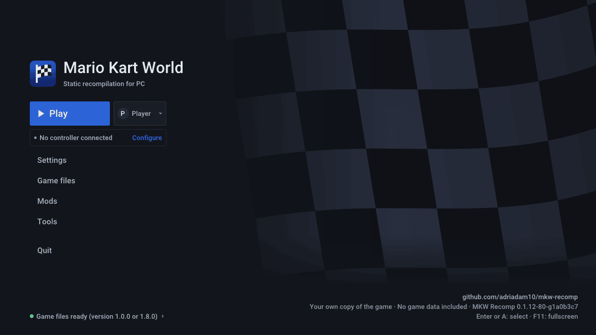

<!-- translated from README.md 84c6832c04b6 body 2a1dd7a634a5 -->

<p align="center"></p>

<h1 align="center">Mario Kart World: Pit Stop</h1>

<p align="center">
  <b>Mario Kart World (Nintendo Switch 2) का नेटिव PlayStation 5 होमब्रू पोर्ट, स्टैटिक रीकम्पाइलेशन से।</b>
</p>

<p align="center">
  <a href="https://github.com/exploitizm/mkw-pit-stop/releases/latest"></a>
</p>

<p align="center">
  <b><a href="https://github.com/exploitizm/mkw-pit-stop/releases">रिलीज़</a></b> ·
  <a href="../../CHANGELOG.md">बदलाव</a> ·
  <a href="../../CONTRIBUTING.md">योगदान</a> ·
  <a href="../../docs/project/roadmap.md">रोडमैप</a> ·
  <a href="../../docs/ps5/ps5.md">PS5 नोट्स</a> ·
  <a href="https://github.com/exploitizm/mkw-pit-stop/issues">इश्यू</a>
</p>

<!-- i18n-bar:start -->
<p align="center">
  <a href="../../README.md">English</a> ·
  <a href="README.zh-CN.md">简体中文</a> ·
  <a href="README.es.md">Español</a> ·
  <a href="README.ar.md">العربية</a> ·
  <b>हिन्दी</b> ·
  <a href="README.pt-BR.md">Português (Brasil)</a> ·
  <a href="README.pt-PT.md">Português (Portugal)</a> ·
  <a href="README.de.md">Deutsch</a>
</p>
<!-- i18n-bar:end -->

[**mkw-recomp**](https://github.com/adriadam10/mkw-recomp) का एक नेटिव PlayStation 5 होमब्रू पोर्ट (`PPSA99193`); mkw-recomp,
Adrià का *Mario Kart World* (Nintendo Switch 2, संस्करण 1.8.0 और 1.0.0) का स्टैटिक रीकम्पाइलेशन है। इसके लिए आपको गेम की अपनी
कॉपी चाहिए, जो आपके अपने Switch 2 कंसोल से डंप की गई हो: इस रिपॉज़िटरी या इसकी रिलीज़ में गेम का कुछ भी नहीं है।

**यह स्टैटिक रीकम्पाइलेशन है, एमुलेटर नहीं।** गेम का AArch64 कोड पहले से C में अनुवादित होता है और PS5 के x86-64 Zen 2 CPU के लिए
कम्पाइल होता है (गेस्ट एड्रेस लेआउट `ps5-high144`); कोई CPU इंटरप्रेटर या JIT नहीं है। GPU भी एमुलेट नहीं होता: Switch 2 का ग्राफ़िक्स
API, NVN2, API स्तर पर Vulkan के ऊपर दोबारा लिखा गया है, जिसमें PS5 के लिए Mesa का RADV ड्राइवर उपयोग होता है, और गेम के SM86 शेडर
आपके PC पर पहले से SPIR-V में अनुवादित होते हैं। Nintendo SDK के फ़ंक्शन (`nn::*`) नाम के आधार पर हमारे अपने कोड से बदले जाते हैं।

> **अपस्ट्रीम PC प्रोजेक्ट:** Linux या Windows संस्करण चाहिए? देखें
> [**adriadam10/mkw-recomp**](https://github.com/adriadam10/mkw-recomp) ([नीचे PC निर्देश](#pc-पर-खेलना-linux-और-windows))।

## स्थिति (PS5)

शुरुआती दौर में, और तेज़ी से आगे बढ़ रहा है। 18/11/2026 तक, एक बेस PS5 पर:

- **बूट, वीडियो, मेनू और रेस काम करते हैं**, RADV के ज़रिए सीधे Vulkan डिस्प्ले, `sceAudioOut` से स्टीरियो साउंड, और साइन-इन किए
  हुए चार तक DualSense कंट्रोलर, वाइब्रेशन और PlayStation बटन आइकन के साथ।
- **रेस डिफ़ॉल्ट रूप से 60 fps पर चलती हैं, फ़्रेम जनरेशन के बिना**: ग्रां प्री बेंचमार्क में औसतन लगभग 57-59 fps; कभी-कभी धीमा
  फ़्रेम रेस को असली समय के 0.95-0.98x पर रखता है ([प्रदर्शन](#प्रदर्शन) देखें)। गेम का 30 fps मोड (पूरी गति) और फ़्रेम जनरेशन
  **Pit Stop > Display** में विकल्प हैं।
- **मल्टीप्लेयर:** गेम का स्प्लिट स्क्रीन (साइन-इन किए हर खिलाड़ी के लिए एक DualSense) और LAN पर इसका लोकल वायरलेस मोड, कई PS5 के बीच
  या उसी संस्करण के PC बिल्ड के साथ ([docs/ps5/multiplayer.md](../../docs/ps5/multiplayer.md))। Nintendo ऑनलाइन प्ले नहीं है।
- **गेम के अंदर Pit Stop ओवरले।** कभी भी **Options + टचपैड क्लिक** दबाकर **Pit Stop** खोलें: कंट्रोलर के लिए बना सेटिंग्स मेनू, जिसमें
  त्वरित पंक्तियाँ (**Master volume**, **Vibration strength**, **Performance HUD**), सभी सेटिंग श्रेणियाँ और DualSense बटनों की लाइव
  रीमैपिंग है, जो `/app0/mkw.ini` में सहेजी जाती है।
- **ज्ञात समस्याएँ ([docs/ps5/roadmap.md](../../docs/ps5/roadmap.md)):**
  - *लंबे सत्र:* गेम पिछले ट्रैकों का डेटा रखता है, इसलिए हर रेस के बाद खाली मेमोरी घटती जाती है; कम होने पर टेक्सचर खराब या गायब हो
    सकते हैं। ऐसा हो तो कुछ रेस के बाद टाइटल दोबारा शुरू करें।
  - *स्पार्स टाइल:* बूट से ही कुछ स्पार्स टेक्सचर टाइल लोड नहीं होतीं: स्टार्ट लाइन के पास हल्की टेक्सचर गड़बड़ी और काला-सफ़ेद रेस इंट्रो।
  - *मल्टीप्लेयर:* किसी ट्रैक की पहली रेस में वह खिलाड़ी हट सकता है जिसके शेडर अभी कम्पाइल हो रहे हों; बाद की रेस ठीक चलती हैं।
    भीड़-भाड़ वाले दृश्यों में स्प्लिट स्क्रीन 30 fps से नीचे चलता है।
  - *मेनू:* मोड, कैरेक्टर और वाहन चुनने की स्क्रीन अभी भी कंसोल से थोड़ी अलग हैं।

## आपको क्या चाहिए

1. **आपके अपने Nintendo Switch 2 से *Mario Kart World* का आपका अपना डंप**: संस्करण **1.8.0** (`exefs/main` बिल्ड ID
   `d00e4f399e411d06`) या 1.0.0 (`9e244438c3d8ef1c`), डिक्रिप्ट किए गए `exefs/` और `romfs/` फ़ोल्डर या `.nup` फ़ाइल के रूप में।
   जिस कंसोल डंप में `updates/` के अंदर 1.8.0 अपडेट हो, वह वैसा ही उपयोग होता है, और दोनों हों तो 1.8.0 बनाया जाता है।
2. **एक जेलब्रेक किया हुआ PS5**, जिसमें होमब्रू पेलोड लोडर (`etaHEN` या `elfldr`), `kstuff`, और **ShadowMountPlus 1.7 Beta 5** या
   नया संस्करण हो (यह `/data/homebrew/PPSA99193` को माउंट करके होम स्क्रीन पर रजिस्टर करता है)। कौन-सा फ़र्मवेयर चलेगा, यह आपके
   जेलब्रेक, `kstuff` और RADV होमब्रू वातावरण पर निर्भर है ([docs/ps5/ps5.md](../../docs/ps5/ps5.md) देखें)।
3. **लगभग 30 GB खाली जगह वाला PC**, PS5 वाले नेटवर्क पर ही, ताकि आपके डंप से टाइटल बनाया जा सके:
   - **Windows 10 या 11 (64-बिट):** और कुछ इंस्टॉल नहीं करना, WSL नहीं। Windows बिल्डर अपना Python, zig और glslc साथ लाता है
     ([Windows के चरण](#windows-पर-इंस्टॉल-करना-wsl-के-बिना))।
   - **Linux x86-64 या WSL2:** `clang`, `lld` और Python 3 ([Linux के चरण](#ps5-पर-इंस्टॉल-और-अपडेट-करना-linux-या-wsl2))।

## Windows पर इंस्टॉल करना (WSL के बिना)

1. **प्लेसहोल्डर टाइटल PS5 पर रखें।** [**रिलीज़**](https://github.com/exploitizm/mkw-pit-stop/releases) से
   `mkw-pit-stop-<version>-ps5-placeholder-PPSA99193.zip` अनज़िप करें और उसका `PPSA99193` फ़ोल्डर किसी FTP क्लाइंट (FileZilla,
   WinSCP) से `/data/homebrew/` में अपलोड करें, ताकि `/data/homebrew/PPSA99193/eboot.bin` मौजूद हो। ShadowMountPlus के रजिस्टर
   करने के बाद **Mario Kart World: Pit Stop** चलाएँ: यह **Game files missing** और `Console IP: <पता> (port 19913)` दिखाता है। वह
   स्क्रीन खुली रहने दें; PS5 फ़ाइलें तभी लेता है जब वह दिख रही हो।
   <p align="center"></p>
2. **PC पर बिल्डर अनपैक करें।** `mkw-pit-stop-<version>-ps5-builder-windows-x86_64.zip` डाउनलोड करें, उस पर राइट-क्लिक करें,
   **Properties**, **Unblock** पर टिक करें, फिर उसे 30 GB खाली जगह वाली ड्राइव के किसी छोटे फ़ोल्डर में निकालें, जैसे `C:\PitStop`
   (`Program Files` या OneDrive नहीं)।
3. **बनाएँ और भेजें।** उस फ़ोल्डर से `mkw.exe` चलाएँ। **Game files** में **Choose folder** (या **Choose .nup or .nx file**) से अपना
   डंप चुनें; **Build for PS5** के नीचे PS5 स्क्रीन वाला पता **PS5 IP** में लिखें और **Build for PS5** दबाएँ। PS5 के लिए डेस्कटॉप वाला
   **Set up** बटन ज़रूरी नहीं है। या उस फ़ोल्डर में Command Prompt से:
   ```bat
   prepare_ps5.bat --source "D:\Dumps\MKW" --send 192.168.1.50
   ```
   <p align="center"></p>
4. **गेम शुरू करें।** PC के बनाते समय PS5 स्क्रीन चरण और प्रगति दिखाती है; जब हर फ़ाइल पहुँचकर जाँच ली जाती है तो यह
   **Transfer complete!** दिखाती है: **क्रॉस** दबाएँ, फिर **Mario Kart World: Pit Stop** दोबारा चलाएँ।

**आपकी कॉपी पहले से PS5 पर है?** **My game files are already on the PS5** पर टिक करें और वहाँ उसका फ़ोल्डर लिखें (जैसे `/data/mkw`,
जिसमें या जिसके `updates\<version>` में `exefs` और `romfs` हों): सिर्फ़ गेम कोड और शेडर भेजे जाते हैं, और टाइटल उस फ़ोल्डर में गेम ढूँढ
लेता है। बनाने के लिए PC को फिर भी आपका डंप चाहिए।

**नेटवर्क नहीं है? USB ड्राइव लें।** चरण 3 में PS5 का पता लिखने के बजाय **To a USB drive** और **Choose drive** चुनें: टाइटल ड्राइव
पर `homebrew\PPSA99193` में लिखा जाता है (**exFAT**, लगभग 25 GB खाली), और ड्राइव PS5 में लगते ही ShadowMountPlus उसे वहाँ ढूँढ लेता है
(यह `/mnt/usb0`-`usb7/homebrew/` खोजता है)। इसके लिए चरण 1 का प्लेसहोल्डर ज़रूरी नहीं; अगर वह इंस्टॉल है, तो पहले
`/data/homebrew/PPSA99193` हटाएँ ताकि टाइटल की एक ही कॉपी रजिस्टर रहे। दोबारा बनाने पर ड्राइव पर सिर्फ़ बदला हुआ हिस्सा अपडेट होता है।

अगर PS5 **Waiting for connection** पर ही रहे, तो पता जाँचें और देखें कि दोनों एक ही नेटवर्क पर हैं; असफल बिल्ड का कारण `mkw.exe` के
पास `logs/setup.log` में लिखा होता है। अपडेट करने के लिए नया बिल्डर अनपैक करें और दोबारा बनाएँ।

## PS5 पर इंस्टॉल और अपडेट करना (Linux या WSL2)

क्योंकि `eboot.bin` रीकम्पाइल किया गया गेम कोड लिंक करता है और `spirv/` में गेम के अनुवादित शेडर होते हैं, **कोई तैयार `eboot.bin` या
`spirv/` वितरित नहीं किया जाता**। आप `PPSA99193` टाइटल फ़ोल्डर अपने PC पर, गेम-रहित रिलीज़ बिल्डर और अपने डंप से बनाते हैं:

1. [**रिलीज़**](https://github.com/exploitizm/mkw-pit-stop/releases) से
   `mkw-pit-stop-<version>-ps5-builder-linux-x86_64.tar.zst` डाउनलोड करें, उसका डाइजेस्ट `SHA256SUMS` से मिलाएँ, और Linux या WSL2 पर
   अनपैक करें:
   ```sh
   tar --zstd -xf mkw-pit-stop-*-ps5-builder-linux-x86_64.tar.zst
   cd mkw-pit-stop-*
   ```
2. अपने *Mario Kart World* डंप (फ़ोल्डर या `.nup` फ़ाइल) की ओर इशारा करते हुए `prepare_ps5.py` चलाएँ:
   ```sh
   python3 prepare_ps5.py --source /path/to/your/mkw-dump --out ./PPSA99193
   ```
   स्क्रिप्ट आपके डंप का संस्करण (1.8.0 या 1.0.0) पहचानती है, AArch64 ExeFS को C (`ps5-high144`) में अनुवादित करती है, पहले से
   बने रनटाइम और PS5 RADV आर्काइव के साथ `eboot.bin` कम्पाइल और लिंक करती है, SM86 निर्देश विनिर्देश स्थानीय रूप से बनाने के लिए NVIDIA
   के `nvdisasm` और `ptxas` (SHA-256 से तय) डाउनलोड करती है, सभी 11,561 शेडर `PPSA99193/spirv/` में अनुवादित करती है, और `exefs/` व
   `romfs/` को `PPSA99193/` में रखती है।
3. `PPSA99193` को FTP या USB से अपने PS5 पर `/data/homebrew/PPSA99193` में भेजें — या `--deploy <PS5_IP>` दें, ताकि अपलोड हो, हर फ़ाइल
   SHA-256 से जाँची जाए, और `/user/app/PPSA99193/sce_sys` में ShadowMountPlus द्वारा रजिस्टर `param.json` और `icon0.png` ताज़ा हों।
4. PS5 की होम स्क्रीन से **Mario Kart World: Pit Stop** चलाएँ।

**अपडेट करना:** नया बिल्डर अनपैक करें और उन्हीं `--work` और `--out` फ़ोल्डरों के साथ `prepare_ps5.py` चलाएँ। जिन चरणों के इनपुट नहीं
बदले (जैसे `romfs/` और बिना बदले शेडर) वे छोड़ दिए जाते हैं, और कंसोल पर आपके सेव (`profile/`) और सेटिंग्स (`mkw.ini`) बने रहते हैं।

## Pit Stop सेटिंग्स ओवरले

किसी भी स्क्रीन से DualSense पर **Options + टचपैड क्लिक** (या डेस्कटॉप पर **F1**) दबाकर **Pit Stop** खोलें
([docs/ps5/pit-stop.md](../../docs/ps5/pit-stop.md)):

| कंट्रोल | काम |
|---|---|
| **Options + टचपैड क्लिक** | किसी भी स्क्रीन से Pit Stop खोलें या बंद करें |
| **D-pad / बायाँ स्टिक ऊपर और नीचे** | एक पंक्ति आगे-पीछे |
| **D-pad / बायाँ स्टिक बाएँ और दाएँ** | चुनी हुई सेटिंग बदलें (बंद/चालू या चरण वाला मान) |
| **सर्कल / क्रॉस** | पुष्टि / वापस (आपके Nintendo या Xbox बटन लेआउट के अनुसार) |
| **L1 / R1** | **All settings** में पिछली / अगली श्रेणी |

- पहली स्क्रीन की **त्वरित पंक्तियाँ** लाइव बदलती हैं: **Master volume** (0–100%), **Vibration strength** (0–300%) और
  **Performance HUD** (Off, FPS, Full)।
- **All settings** में **Display**, **Graphics**, **Controls** (हर एक्शन के लिए लाइव बटन कैप्चर), **Audio**, **General**,
  **Advanced**, **Hacks** (सभी ड्राइवर, वाहन, स्टिकर और स्पेशल कप अनलॉक) और **Multiplayer** खुलते हैं। बदलाव अपने-आप
  `/app0/mkw.ini` में सहेजे जाते हैं।

## PC पर खेलना (Linux और Windows)

अपस्ट्रीम [mkw-recomp](https://github.com/adriadam10/mkw-recomp) से:

<p align="center">
  
  
</p>

1. अपने Switch 2 से Mario Kart World 1.0.0 या 1.8.0 डंप करें (`exefs/` और `romfs/`, डिक्रिप्ट किए हुए)।
2. [mkw-recomp की रिलीज़](https://github.com/adriadam10/mkw-recomp/releases) से PC लॉन्चर डाउनलोड करें: Linux पर `.AppImage`
   (बनाया गया गेम `~/.local/share/mkw-recomp` में रखता है; glibc 2.31 या नया), Windows पर `.zip`। दोनों को लगभग 30 GB खाली जगह
   चाहिए।
3. AppImage या `mkw.exe` चलाएँ, **Game files** खोलें, अपना डंप चुनें और **Prepare** दबाएँ, फिर **Play**।

## सोर्स से बनाना

### PS5 नेटिव टारगेट (`PPSA99193`)

`PS5_VulkanTemplate`, `PS5_Vulkan`, `PS5_Mesa` और `PS5_PayloadSDK` के तय चेकआउट के लिए [docs/ps5/ps5.md](../../docs/ps5/ps5.md) और
[tools/ps5/README.md](../../tools/ps5/README.md) देखें:

```sh
python3 recomp/gen.py --exefs "$MKW_GAME/exefs" --guest-layout ps5-high144 \
    --out build/ps5-game/generated --patches recomp/patches-mkw.txt
python3 tools/shaders/extract.py && python3 tools/shaders/translate.py
python3 tools/ps5/build_game.py --stack "$stack" --include "$headers" \
    --generated build/ps5-game/generated --exefs "$MKW_GAME/exefs"
python3 tools/ps5/deploy.py <PS5_IP> --game
```

रनटाइम इन्वेंटरी (`--inventory`) से गेम-रहित PS5 बिल्डर रिलीज़ पैक करने के लिए:

```sh
python3 tools/ps5/build_game.py --stack "$stack" --include "$headers" --inventory
python3 tools/ps5/release_ps5.py --stack "$stack" --version 0.1.0
```

### Linux और Windows होस्ट बिल्ड

विवरण [tools/build/README.md](../../tools/build/README.md) में:

```sh
python3 recomp/gen.py --exefs game/exefs --out build/generated --jobs 8 --patches recomp/patches-mkw.txt
python3 tools/shaders/extract.py && python3 tools/shaders/translate.py
python3 tools/build/build.py              # build/mkw; --target windows builds mkw.exe with llvm-mingw
build/mkw
```

| फ़ोल्डर | सामग्री |
|---|---|
| [recomp/](../../recomp/README.md) | जनरेटर: AArch64 → C |
| [runtime/](../../runtime/README.md) | कंसोल की जगह लेने वाला हिस्सा: कर्नेल, मेमोरी, SDK के विकल्प, Vulkan पर NVN2, ऑडियो, इनपुट, Pit Stop और लॉन्चर |
| [sm86/](../../sm86/README.md) | शेडर अनुवादक: SM86 SASS → GLSL → SPIR-V |
| [tools/](../../tools/README.md) | विश्लेषण, सेटअप, बिल्ड, PS5 पैकेजिंग, गेम रन और डायग्नॉस्टिक्स |
| [tests/](../../tests/README.md) | गेम या GPU के बिना टेस्ट, Linux और Windows की CI में |
| [docs/](../../docs/README.md) | PS5 आर्किटेक्चर, Pit Stop, शोध, स्रोत, रोडमैप और प्रदर्शन |
| [i18n/](../../i18n/README.md) | मेनू के टेक्स्ट gettext फ़ाइलों के रूप में (`mkw.pot`, हर भाषा के लिए एक `.po`) |
| [server/](../../server/README.md) | इंटरनेट पर लोकल-वायरलेस खेल के लिए लॉबी सर्वर (`server/lobby`) |
| `.github/` | CI, इश्यू और पुल रिक्वेस्ट टेम्पलेट |

रूट में: `pyproject.toml` और `uv.lock` (टूल्स का Python वातावरण), `Makefile` (रिलीज़ और CI के शॉर्टकट), `.gitignore`, `LICENSE`,
`CONTRIBUTING.md`, `CHANGELOG.md` (हर रिलीज़ के बदलाव, उसके नोट्स), `AGENTS.md` (कोडिंग एजेंटों के लिए गाइड)।

## प्रदर्शन

एक बेस PS5 पर, Mario Kart World 1.8.0, ग्रां प्री रेस बेंचमार्क (`tools/ps5/bench.py`, 210 s रेस, 1080p, फ़्रेम जनरेशन बंद):

| तारीख | फ़्रेम रेट सेटिंग | औसत फ़्रेम समय | सामान्य फ़्रेम | 1% लो | रेस की गति |
|---|---|---|---|---|---|
| 20/11/2026 | 60 fps (नया डिफ़ॉल्ट) | 17.0–17.4 ms (57–59 fps) | 16.7 ms (सीमा पर) | 35–41 fps | 0.95–0.98x |
| 16/11/2026 | 30 fps (पिछला डिफ़ॉल्ट) | 33.3 ms | 33.3 ms | | 1.00x |

नया डिफ़ॉल्ट कंसोल पर उसी रूप में नहीं जाँचा गया है जिसमें वह जारी होता है: ये आँकड़े उन बेंचमार्क रेस से हैं जिनमें रनटाइम का प्रदर्शन लॉग
चालू था (`MKW_TRACE=perf`, जिसकी थोड़ी लागत है) और जिन्हें हाथ से 60 fps पर सेट किया गया था। मेनू, टाइम ट्रायल, स्प्लिट स्क्रीन, लंबे
सत्र और दूसरे ट्रैक अभी नए डिफ़ॉल्ट पर नहीं खेले गए हैं।

लगभग 2% रेस फ़्रेम 20 ms से ज़्यादा लेते हैं: ये वहाँ होते हैं जहाँ कोई ट्रैक नए टेक्सचर लोड करता है, और यही 1% लो और हल्की स्लो मोशन तय
करते हैं। क्या मापा गया और क्या बाकी है, यह [docs/ps5/roadmap.md](../../docs/ps5/roadmap.md) और
[docs/ps5/ps5.md](../../docs/ps5/ps5.md#frame-rate) में है; PC के आँकड़े [docs/project/performance.md](../../docs/project/performance.md) में।

## बग रिपोर्ट करना

[CONTRIBUTING.md](../../CONTRIBUTING.md) देखें। PS5 समस्याएँ [इस फ़ोर्क के इश्यू](https://github.com/exploitizm/mkw-pit-stop/issues) में
रिपोर्ट करें और कंसोल का कर्नेल लॉग (`klog`, `[Mario Kart World: Pit Stop]` उपसर्ग के साथ) और PC बिल्डर का `logs/setup.log` संलग्न
करें। डेस्कटॉप समस्याओं के लिए `logs/mkw.log` और `logs/setup.log` संलग्न करें। गेम फ़ाइलें, डंप, या आपके डंप से बने `eboot.bin` कभी
संलग्न न करें।

## लाइसेंस, श्रेय और अस्वीकरण

इस रिपॉज़िटरी का सोर्स कोड [MIT लाइसेंस](../../LICENSE) (`Copyright (c) 2026 Adrià`) के अंतर्गत है।

**PS5 रिलीज़ फ़ाइलें GPL-3.0-or-later हैं।** हर PS5 टाइटल पेलोड SDK फ़ोर्क की प्लेटफ़ॉर्म लेयर और `PS5_Vulkan` का स्टार्ट-अप कोड
(GPL-3.0-or-later) लिंक करता है, इसलिए प्लेसहोल्डर टाइटल, बिल्डर का `ps5-bundle/` और इनसे बनाया गया हर टाइटल पूरे रूप में
GPL-3.0-or-later के अंतर्गत है; mkw-recomp का अपना कोड MIT ही रहता है। हर रिलीज़ में `LEGAL.txt` और `licenses/` (हर हिस्सा उसके
लाइसेंस, कॉपीराइट और सोर्स रिविज़न के साथ) होते हैं और हर हिस्से का पूरा सोर्स `source/*.tar.gz` (`source/SOURCES.txt`) के रूप में
संलग्न होता है, जो [tools/ps5/release_notices.py](../../tools/ps5/release_notices.py) बनाता है।

- **अपस्ट्रीम प्रोजेक्ट:** Adrià का [**mkw-recomp**](https://github.com/adriadam10/mkw-recomp) — AArch64→C लिफ़्टर, Switch 2 कर्नेल
  और `nn::*` SDK के विकल्प, Vulkan पर NVN2 रेंडरर, और ऑफ़लाइन SM86→SPIR-V शेडर अनुवादक।
- **MIT और अनुमेय (permissive) प्रोजेक्ट** ([recomp/](../../recomp/), [runtime/](../../runtime/), [sm86/decode/](../../sm86/decode/) और
  [runtime/third_party/](../../runtime/third_party/README.md) में `LICENSE.*` फ़ाइलें):
  [totk-pc-recomp](https://github.com/valentderah/totk-pc-recomp) और उसका Linux पोर्ट,
  [SavageWindRecomp](https://github.com/Revivedx/SavageWindRecomp),
  [DocumentSASS](https://github.com/0xD0GF00D/DocumentSASS) और
  [nvsass-disassembler](https://github.com/reoLantern/nvsass-disassembler),
  [Ryujinx](https://git.ryujinx.app/ryubing/ryujinx), [Mesa NAK](https://gitlab.freedesktop.org/mesa/mesa/-/tree/main/src/nouveau/compiler),
  [mario-kart-world-save-editor](https://github.com/Ca1nM/mario-kart-world-save-editor), Dear ImGui,
  [bc7enc_rdo](https://github.com/richgel999/bc7enc_rdo), AMD FidelityFX FSR 1, Vulkan Memory Allocator, Roboto और Lato।
- **PS5 टूलचेन और रनटाइम:** [PS5_VulkanTemplate](https://github.com/mihawk-99/PS5_VulkanTemplate) (MIT, Sascha Willems और
  Mihawk), [PS5_Mesa](https://github.com/mihawk-99/PS5_Mesa) (MIT, PS5 के लिए RADV),
  [PS5_Vulkan](https://github.com/mihawk-99/PS5_Vulkan) और [PS5_PayloadSDK](https://github.com/mihawk-99/PS5_PayloadSDK)
  (GPL-3.0-or-later, Mihawk और [John Törnblom / ps5-payload-dev](https://github.com/ps5-payload-dev/sdk)), और
  [ShadowMountPlus](https://github.com/drakmor/shadowMountPlus)। पेलोड SDK प्लेटफ़ॉर्म लेयर और `PS5_Vulkan` CRT/स्टब के साथ किसी
  PS5 टाइटल में लिंक होने पर, मिला हुआ PS5 टाइटल बाइनरी GPL-3.0-or-later के अंतर्गत आता है (बने हुए टाइटल के अंदर `LEGAL.txt` और
  `licenses/`)।
- **सिर्फ़ शोध और डिज़ाइन के विचार** (GPL या बिना लाइसेंस वाले प्रोजेक्टों से कोई कोड कॉपी नहीं किया गया): eden-nx2, Hookshot,
  PS5_Hookshot, EglantinePS5, AnyPS5, prosper और shadPS4। हर स्रोत [docs/project/research.md](../../docs/project/research.md#sources) में
  दर्ज है।

**अस्वीकरण:** *Mario Kart World* और *Mario* Nintendo के ट्रेडमार्क हैं। "PlayStation" और "PS5" Sony Interactive Entertainment Inc.
के ट्रेडमार्क हैं। यह प्रोजेक्ट Nintendo, Sony Interactive Entertainment या किसी गेम प्रकाशक से संबद्ध या उनके द्वारा समर्थित नहीं है, इसमें
कोई गेम कोड, शेडर या एसेट नहीं हैं, और यह उन्हें पाने में मदद नहीं करता।
